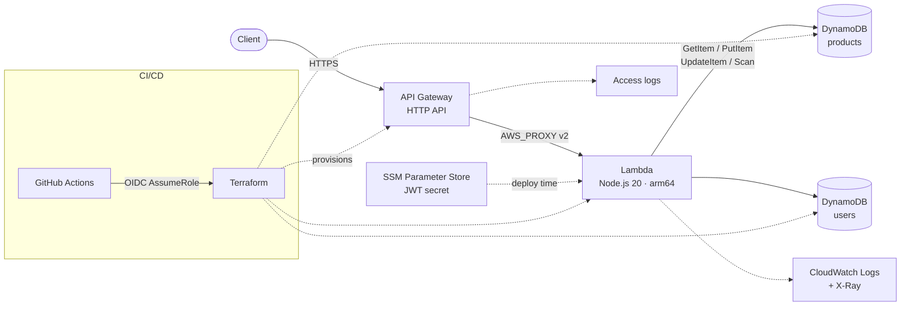

# AWS Lambda REST API

[](https://github.com/CH88320B/aws-lambda-rest-api/actions/workflows/ci.yml)


A production-style **serverless REST API** for a product catalog, built with Node.js on **AWS Lambda**, exposed through **API Gateway (HTTP API)** and persisted in **DynamoDB**. Infrastructure is fully defined in **Terraform** and deployed by **GitHub Actions** using OIDC (no long-lived AWS keys).

## Features

- **Product CRUD** with cursor-based pagination and category filtering
- **JWT authentication** (register / login / me) with bcrypt password hashing
- **Role-based authorization**: writes need a valid token, deletes need `admin`
- **Input validation** with field-level error details (`422`)
- **OpenAPI 3 spec + Swagger UI** served by the API itself at `/docs`
- **Terraform IaC**: Lambda (arm64), HTTP API, DynamoDB, least-privilege IAM, SSM SecureString, X-Ray, access logs, throttling
- **CI/CD**: lint, unit tests with coverage gates, `terraform validate`, and OIDC deploy with a post-deploy smoke test
- **Local development** against DynamoDB Local via Docker Compose

## Architecture



A single Lambda handles every route through a small internal router. This keeps cold starts low and makes the whole API testable in-process by calling `handler(event)` directly.

## API

| Method | Path | Auth | Description |
|--------|------|------|-------------|
| `GET` | `/health` | – | Health check |
| `GET` | `/docs` | – | Swagger UI |
| `POST` | `/auth/register` | – | Create an account, returns a JWT |
| `POST` | `/auth/login` | – | Exchange credentials for a JWT |
| `GET` | `/auth/me` | Bearer | Current user profile |
| `GET` | `/products?limit=&cursor=&category=` | – | List products (paginated) |
| `GET` | `/products/{id}` | – | Get a product |
| `POST` | `/products` | Bearer | Create a product |
| `PUT` | `/products/{id}` | Bearer | Partially update a product |
| `DELETE` | `/products/{id}` | Bearer (admin) | Delete a product |

Full contract: [`docs/openapi.yaml`](docs/openapi.yaml).

### Example

```bash
# Register and capture the token
TOKEN=$(curl -s -X POST $API_URL/auth/register \
  -H 'Content-Type: application/json' \
  -d '{"email":"jane@example.com","password":"s3cure-pass","name":"Jane"}' | jq -r .token)

# Create a product
curl -s -X POST $API_URL/products \
  -H "Authorization: Bearer $TOKEN" \
  -H 'Content-Type: application/json' \
  -d '{"name":"Mechanical Keyboard","price":89.9,"stock":25,"category":"peripherals"}'

# Page through products
curl -s "$API_URL/products?limit=10"
curl -s "$API_URL/products?limit=10&cursor=<nextCursor>"
```

Validation errors look like:

```json
{
  "error": "Validation failed",
  "details": [
    { "field": "price", "message": "must be >= 0" },
    { "field": "stock", "message": "must be an integer" }
  ]
}
```

## Getting started

### Prerequisites

- Node.js 20+
- Docker (for DynamoDB Local)
- Terraform 1.6+ and an AWS account (for deployment only)

### Run locally

```bash
npm install
docker compose up -d        # DynamoDB Local on :8000
npm run local               # API on http://localhost:3000, docs at /docs
```

The local server creates the tables automatically on startup.

### Test

```bash
npm test      # Jest unit tests with coverage thresholds
npm run lint  # ESLint
```

AWS SDK calls are mocked with `aws-sdk-client-mock`, so tests run offline and in milliseconds.

## Deployment

### 1. Remote state

Create an S3 bucket and a DynamoDB lock table (once per account), then:

```bash
cp terraform/backend.hcl.example terraform/backend.hcl   # edit bucket/table names
```

### 2. Build and apply

```bash
npm run package                          # builds dist/ with production deps only
cd terraform
terraform init -backend-config=backend.hcl
terraform apply -var-file=environments/dev.tfvars
terraform output api_url
```

### 3. Continuous deployment

The `Deploy` workflow runs after `CI` succeeds on `main`, or on demand. Configure these repository variables:

| Variable | Description |
|----------|-------------|
| `AWS_ROLE_ARN` | IAM role trusted for GitHub OIDC (`token.actions.githubusercontent.com`) |
| `AWS_REGION` | Target region (default `us-east-1`) |
| `TF_STATE_BUCKET` | S3 bucket for Terraform state |
| `TF_LOCK_TABLE` | DynamoDB table for state locking |

Until `AWS_ROLE_ARN` is set, the deploy job is skipped.

## Project structure

```
.
├── src/
│   ├── index.js              # Lambda entry point + route table
│   ├── handlers/             # auth, products, docs
│   └── lib/                  # router, auth middleware, validation, DynamoDB client, responses
├── tests/                    # Jest unit tests
├── docs/openapi.yaml         # OpenAPI 3 contract
├── terraform/                # Infrastructure as code
│   └── environments/         # Per-environment tfvars
├── scripts/                  # Local server and Lambda packaging
└── .github/workflows/        # CI and deploy pipelines
```

## Design notes

- **Users are keyed by normalized email**, so login is a single `GetItem` with no GSI. The user `id` stays stable for token subjects.
- **Constant-time-ish login**: unknown emails still run a bcrypt comparison, so response timing doesn't reveal which emails are registered.
- **Conditional writes** (`attribute_not_exists` / `attribute_exists`) prevent duplicate registrations and turn updates or deletes of missing items into `404` without a prior read.
- **Opaque cursors**: `LastEvaluatedKey` is base64url-encoded so clients never depend on the table's key schema.

## License

[MIT](LICENSE)
